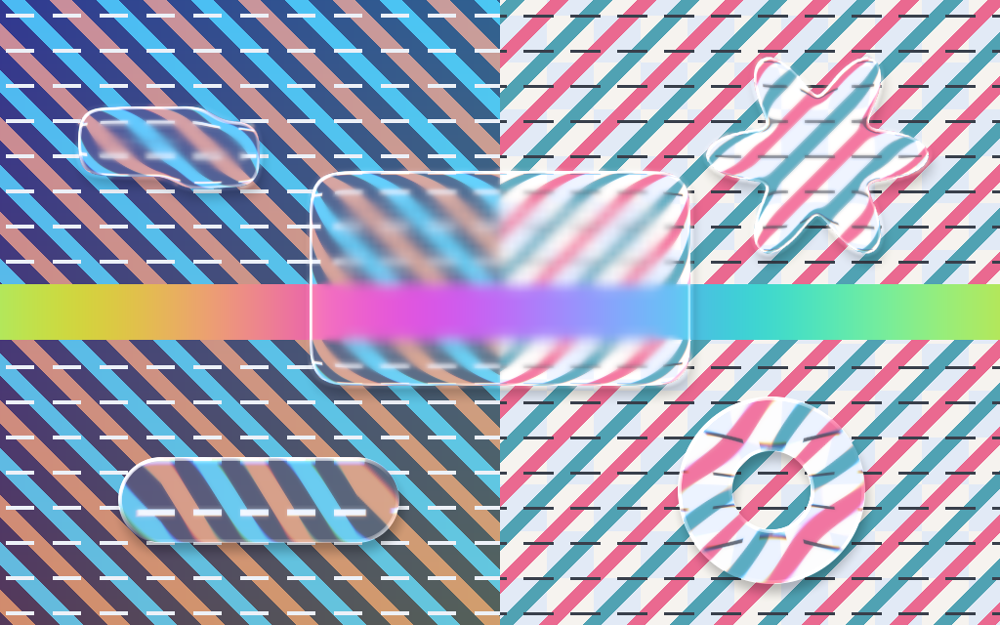

<h1 align="center">liquid glass (clean-room GLSL 440)</h1>

<p align="center">
  <a href="#features">Features</a> ·
  <a href="#pipeline">Pipeline</a> ·
  <a href="#passes--files">Passes & Files</a> ·
  <a href="#build--verification">Build & Verification</a> ·
  <a href="#web-port-plan">Web Port Plan</a> ·
  <a href="#limitations">Limitations</a> ·
  <a href="README.md">Русский</a>
</p>

An independent, MIT-licensed clean-room optical frosted/refractive glass shader suite written in **GLSL `#version 440`** with shared Qt6 RHI-compatible `std140` UBO layouts (`.qsb`), Vulkan SPIR-V, and OpenGL 4.5+ SPIR-V targets. Implements G2-continuous squircles, smooth droplet coalescing, 5-pass JFA mask-to-SDF reconstruction with Gaussian pre-smoothed normals, capture-clamped 13-tap mip pyramids, achromatic 7-tap spectral dispersion, luma-adaptive bevel highlights, and 3D Snell thin-lens ray tracing with Total Internal Reflection (TIR) safety.

> **as of the latest commit:**
> - all 10 shaders (`glass_quad.vert` + 9 `.frag`) compile and validate cleanly across 4 independent toolchains: `glslangValidator -V` + `spirv-val`, `glslc` + `spirv-val`, `glslangValidator -G` + `spirv-val --target-env opengl4.5`, and Qt6 `/usr/lib/qt6/bin/qsb` (`100 es, 120, 330, 440`).
> - math invariants are verified on CPU (`tests/verify_invariants.py`, 6 suites) and GPU via headless EGL Surfaceless OpenGL 4.6 SPIR-V (`tests/egl_render_test.c`, 6 GPU checks on **NVIDIA GeForce RTX 5070**).
> - **native Hyprland 0.57.2 C++ plugin (`plugin/`):** implemented on **OpenGL ES 3.20** with single-source shader generation ([plugin/README.md](plugin/README.md)), built cleanly (`GCC 16.2.1 -std=c++23 -Wall -Wextra -Werror`) with ABI hash + all 173 non-weak ELF symbols verified against `/usr/bin/Hyprland`, and verified on GPU via standalone EGL ES 3.2 harness (`plugin/tests/gles_plugin_test.cpp`).
> - **pending live session run:** live interactive `hyprctl plugin load` verification inside a user GUI session has not been executed automatically (all verification so far runs via standalone GPU harnesses and ELF ABI verification). KDE KWin and the web runtime come next; see [docs/WEB_PORT_PLAN.md](docs/WEB_PORT_PLAN.md).

<p align="center"></p>

<p align="center"><sub>Synthetic 1024×640 showcase (`tests/egl_render_test.c`): bridging dark indigo and bright warm paper halves. Top-left: smooth-min coalescing capsules; center: G2-squircle panel with 3-band frost & spectral dispersion; top-right: arbitrary 6-lobe alpha mask via 5-pass GPU JFA; bottom: 3D Snell thin-lens capsule and torus loupe.</sub></p>

## features

<table>
<tr>
<td width="50%" valign="top">
<b>Analytic G2-Squircles & Merging</b><br>
Superellipse corner continuity (`smoothness`), ellipse morphing (`sdSquircleEllipse`), and C1 smooth-minimum coalescing (`smoothMinPoly`) across dual shapes in a single fragment pass.
</td>
<td width="50%" valign="top">
<b>5-Pass JFA Mask-to-SDF</b><br>
Arbitrary bitmap/alpha silhouettes (`jfa_seed` -> log2 `jfa_step` -> sub-pixel `0.5 - seedAlpha` resolve -> separable Gaussian pre-blur -> `sdf_pack_normals`) with <0.25 px RMS distance accuracy.
</td>
</tr>
<tr>
<td width="50%" valign="top">
<b>Border-Safe Clamped Mip Pyramid</b><br>
13-tap dual-ring box downsample (`downsample_clamped.frag`) clamps every tap inside `uvClampRect` (inset >= 0.5 texel), keeping uniform interior regions free from outer black/transparent bleed across 4+ mip levels.
</td>
<td width="50%" valign="top">
<b>Achromatic 7-Tap Dispersion</b><br>
Overlapping spectral curve weights (`spectralTapWeight`) sum strictly to `(1.0, 1.0, 1.0)` across R, G, and B so neutral grays remain perfectly achromatic while high-contrast boundaries show prismatic separation.
</td>
</tr>
<tr>
<td width="50%" valign="top">
<b>3D Snell Thin-Lens + TIR</b><br>
Ray-traces semicircular capsule and torus profiles levitated over the backdrop (`traceSnellThinLens`). When `ior < 1.0` exceeds the critical angle (`k < 0`), smoothly transitions to TIR reflection with zero NaNs/Infs.
</td>
<td width="50%" valign="top">
<b>Linear Light, HDR Clamp & Overlay</b><br>
Epsilon-guarded un-premultiply, 3×4 affine color grading, Rec.709 `lumaAdaptiveResponse` specular modulation, hue-preserving highlight compression (`huePreservingClamp`), and full-composite or strict premultiplied overlay output.
</td>
</tr>
</table>

## pipeline

```text
  [Backdrop Capture Texture]                  [Arbitrary Alpha Mask Texture]
              │                                             │
              ▼                                             ▼
  (A) downsample_clamped.frag × 5             (B1) jfa_seed.frag (4-connected perimeter)
      (13-tap + uvClampRect)                                │
              │                                             ▼
              ├───► mip 0..5 pyramid          (B2) jfa_step.frag × ceil(log2 N) + 1
              │                                             │
              ▼                                             ▼
  (C) variable_blur.frag                      (B3) sdf_resolve.frag (d + 0.5 - seedAlpha)
      (r=2 smooth-knee, 4-tap scatter,                      │
       unpremultiply + dither)                              ▼
              │                               (B4) sdf_smooth.frag ─► sdf_pack_normals.frag
              │                                             │
              └───────────────────────┬─────────────────────┘
                                      ▼
              (D) liquid_glass_panel.frag   or   snell_lens_glass.frag
                  (G2-squircle / JFA + 3-band)   (3D capsule / torus + Snell + TIR)
```

## passes & files

| Category | Description | Location |
|---|---|---|
| Core math & color | `clampUV`, `sampleMaskChannel`, `unpremultiplySafe`, 3×4 grade, `huePreservingClamp`, 7-tap spectrum, IGN/triangular dither | [shaders/include/glass_common.glsl](shaders/include/glass_common.glsl) |
| SDF & surface lighting | `sdSquircleEllipse`, `smoothMinPoly`, capsule/torus geometry, `fwidth` AA, `evalBevelHighlight`, `evalCosineRimGlow` | [shaders/include/glass_sdf.glsl](shaders/include/glass_sdf.glsl) |
| Optics & compositing | `convexBevelProfile`, multi-band sampling, `traceSnellThinLens`, drop shadow, shared composite/overlay finalizers | [shaders/include/glass_optics.glsl](shaders/include/glass_optics.glsl) |
| Vertex stage | Fullscreen / item quad with `qt_Matrix` prefix | [shaders/glass_quad.vert](shaders/glass_quad.vert) |
| Pyramid & blur | `downsample_clamped.frag` (13-tap) and `variable_blur.frag` (C0 smooth-knee LOD, 4-tap scatter, dither) | [shaders/downsample_clamped.frag](shaders/downsample_clamped.frag), [shaders/variable_blur.frag](shaders/variable_blur.frag) |
| JFA Mask-to-SDF | Seed extraction, Jump Flooding ping-pong, sub-pixel resolve, separable/single Gaussian smoothing, normal packing | [shaders/jfa_seed.frag](shaders/jfa_seed.frag), [shaders/jfa_step.frag](shaders/jfa_step.frag), [shaders/sdf_resolve.frag](shaders/sdf_resolve.frag), [shaders/sdf_smooth.frag](shaders/sdf_smooth.frag), [shaders/sdf_pack_normals.frag](shaders/sdf_pack_normals.frag) |
| Glass shaders | Unified panel shader (analytic or JFA SDF+normal map) and 3D Snell thin-lens refraction shader | [shaders/liquid_glass_panel.frag](shaders/liquid_glass_panel.frag), [shaders/snell_lens_glass.frag](shaders/snell_lens_glass.frag) |
| Build & test suite | 4-toolchain compile/validate script, CPU/NumPy mathematical invariants, headless EGL/GL 4.6 SPIR-V GPU harness | [scripts/build_shaders.sh](scripts/build_shaders.sh), [tests/verify_invariants.py](tests/verify_invariants.py), [tests/egl_render_test.c](tests/egl_render_test.c) |
| Native Hyprland plugin | `#version 320 es` generator, `IGLBlurProvider` hook, `plugin:liquid_glass:*` config, `CLiquidGlassPipeline`, ES 3.2 test | [plugin/README.md](plugin/README.md), [scripts/gen_plugin_shaders.py](scripts/gen_plugin_shaders.py), [plugin/src/main.cpp](plugin/src/main.cpp) |
| Web architecture plan | Detailed Russian blueprint for `Web Lite` fast-paths, WebGL2/WebGPU runtime & CSS/DOM accessibility layer | [docs/WEB_PORT_PLAN.md](docs/WEB_PORT_PLAN.md) |

## build & verification

Linux prerequisites: `glslangValidator`, `glslc`, `spirv-val`, Qt6 `qsb` (default `/usr/lib/qt6/bin/qsb`), `gcc`/`g++`, `EGL`/`GL`/`GLES3` headers (`glcorearb.h`), `python3` with `numpy`; plus `hyprland`, `pixman-1`, `libdrm` headers for the native plugin.

```bash
# full shader build + native Hyprland plugin + all CPU/GPU suites (GL 4.6 SPIR-V and ES 3.2)
make clean && make

# individual targets:
make shaders          # compiles .spv (Vulkan/GL), runs spirv-val, bakes Qt6 .qsb under build/
make plugin           # builds plugin/build/liquid-glass.so for Hyprland 0.57.2
make test-invariants  # CPU/NumPy checks (JFA <0.25 px RMS, neutral gray achromaticity, LOD, Snell/TIR)
make test-egl         # executes compiled GL SPIR-V on GPU via headless EGL & saves build/render_preview.png
make test-plugin      # executes the plugin's OpenGL ES 3.20 pipeline on GPU (plugin/build/gles_plugin_test)
```

## web port plan

See [docs/WEB_PORT_PLAN.md](docs/WEB_PORT_PLAN.md) for the full web adaptation roadmap (`Web Lite` 4-tier early-out dropping interior fetches from 21+ to 1, Scene-Backed WebGL2 + dirty-scheduler + accessible transparent DOM overlay, and pure CSS `backdrop-filter` + `in oklch` + `drop-shadow()` fallback).

## limitations

- **Single verified hardware stack:** verified locally on Linux with an `NVIDIA GeForce RTX 5070` via headless EGL OpenGL 4.6 Core and OpenGL ES 3.2; not yet benchmarked on AMD `RADV`, Intel `Iris`/`ANV`, or mobile tile GPUs.
- **Pending live Hyprland session run:** `plugin/build/liquid-glass.so` is compiled against system `Hyprland v0.57.2` with ABI exports and ELF symbol resolution verified, and `CLiquidGlassPipeline` is verified on GPU via `plugin/tests/gles_plugin_test.cpp`, while loading into your interactive compositor session via `hyprctl plugin load` is ready for you to test (see [plugin/README.md](plugin/README.md)). KDE KWin Effect and the web runtime are future steps.
- **Full-quality texture bandwidth:** `liquid_glass_panel.frag` runs multi-band + 7-tap sampling uniformly (~28–29 fetches/pixel when multi-band is enabled) without an interior-flatness skip; a compositor/mobile deployment should enable the interior fast-path described in the web plan.
- **HDR10 / PQ transfer functions:** the Hyprland plugin handles SDR sRGB↔Linear conversion and linear input FBOs (`CM_TRANSFER_FUNCTION_LINEAR` / `EXT_LINEAR`), while PQ/HLG HDR curves are not yet implemented.

---

<sub>License: <a href="LICENSE">MIT</a> (2026)</sub>
