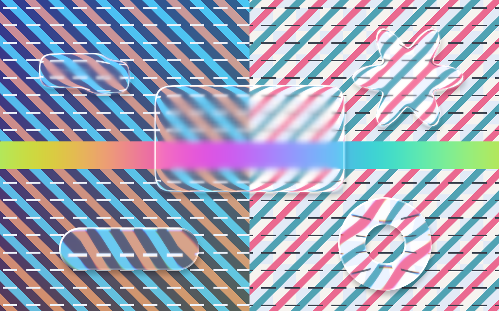

<h1 align="center">liquid glass (clean-room GLSL 440)</h1>

<p align="center">
  <a href="#возможности">Возможности</a> ·
  <a href="#как-работает-конвейер">Как работает конвейер</a> ·
  <a href="#проходы-и-файлы">Проходы и файлы</a> ·
  <a href="#сборка-и-проверка">Сборка и проверка</a> ·
  <a href="#план-порта-в-веб">План порта в веб</a> ·
  <a href="#ограничения-и-что-не-сделано">Ограничения</a> ·
  <a href="README.en.md">English</a>
</p>

Набор независимых (clean-room, MIT) шейдеров оптического преломляющего стекла на **GLSL `#version 440`** с общей UBO-раскладкой `std140` для Qt6 RHI (`.qsb`), Vulkan SPIR-V, OpenGL 4.5+ SPIR-V и нативных композиторов Linux. Реализует G2-сквирклы, плавное слияние фигур, JFA-реконструкцию дистанционного поля из произвольной альфа-маски, изолированную от границ мип-пирамиду, 7-tap спектральную дисперсию, адаптивный по люме блик на фаске и 3D-линзы по закону Снеллиуса с защитой от полного внутреннего отражения (TIR).

> **на момент последнего коммита:**
> - все 10 шейдеров (`glass_quad.vert` + 9 `.frag`) собираются и проходят проверку в 4 независимых тулчейнах: `glslangValidator -V` + `spirv-val`, `glslc` + `spirv-val`, `glslangValidator -G` + `spirv-val --target-env opengl4.5` и Qt6 `/usr/lib/qt6/bin/qsb` (`100 es, 120, 330, 440`).
> - математические инварианты проверены на CPU (`tests/verify_invariants.py`, 6 тестов) и на GPU через headless EGL Surfaceless OpenGL 4.6 SPIR-V (`tests/egl_render_test.c`, 6 GPU-проверок на **NVIDIA GeForce RTX 5070**).
> - **что пока не сделано:** живая обвязка под Wayland-композитор (Hyprland C++ плагин / KDE KWin Effect / Quickshell QSB) и веб-рантайм. Для веба подготовлен только подробный архитектурный план — [docs/WEB_PORT_PLAN.md](docs/WEB_PORT_PLAN.md).

<p align="center"></p>

<p align="center"><sub>Синтетическая сцена 1024×640 (`tests/egl_render_test.c`): тёмный и светлый фон одновременно. Слева сверху — плавное слияние пары капсул, в центре — G2-сквиркл с многозонным размытием и дисперсией, справа сверху — 6-лепестковая маска через 5-проходной GPU JFA, снизу — 3D-линзы Снеллиуса (капсула и тороидальная лупа).</sub></p>

## возможности

<table>
<tr>
<td width="50%" valign="top">
<b>Аналитика G2-сквирклов и слияние</b><br>
Суперэллипс-углы с настраиваемой гладкостью (`smoothness`) и морфингом в эллипс (`sdSquircleEllipse`), C1-непрерывное слияние двух виджетов (`smoothMinPoly`) без треугольной геометрии.
</td>
<td width="50%" valign="top">
<b>5-проходной JFA Mask-to-SDF</b><br>
Для произвольных не-аналитических масок (иконки, лепестки, кривые SVG): выделение 4-связной границы (`jfa_seed`), Jump Flooding с субпиксельной поправкой покрытия (`0.5 - seedAlpha`) и гауссово сглаживание перед расчётом нормалей.
</td>
</tr>
<tr>
<td width="50%" valign="top">
<b>Клемпленная мип-пирамида</b><br>
13-tap двухкольцевой бокс-даунсэмпл (`downsample_clamped.frag`) жестко зажимает все выборки внутри `uvClampRect` (отступ ≥ 0.5 текселя от края захвата). Чёрный бордюр за областью окна не протекает в размытие даже на mip 4–5.
</td>
<td width="50%" valign="top">
<b>7-tap дисперсия без паразитного тинта</b><br>
Перекрывающиеся спектральные веса (`spectralTapWeight`) суммируются в точную `(1.0, 1.0, 1.0)` по каждому каналу: яркие контрастные границы расщепляются по спектру, а нейтрально серый или белый фон остаётся строго ахроматичным.
</td>
</tr>
<tr>
<td width="50%" valign="top">
<b>3D-линзы Снеллиуса + TIR</b><br>
Попиксельная трассировка луча через полукруглый профиль (капсула или тор) на высоте `levitationPx` над фоном (`traceSnellThinLens`). При `ior < 1.0` и критическом угле падения ветвь `k < 0` мягко переходит в серебристый блик полного внутреннего отражения без `NaN`/`Inf`.
</td>
<td width="50%" valign="top">
<b>Линейный свет, HDR-клемп и оверлей</b><br>
Безопасный un-premultiply (`unpremultiplySafe`), 3×4 цветокоррекция, перцептивный отклик блика по люме (`lumaAdaptiveResponse`), сохраняющий тон ограничитель пиков (`huePreservingClamp`) и два режима выхода: полный композит или чистый преумноженный RGBA-оверлей.
</td>
</tr>
</table>

## как работает конвейер

```text
  [Подложка окна / рабочего стола]               [Произвольная альфа-маска]
                │                                             │
                ▼                                             ▼
    (A) downsample_clamped.frag × 5               (B1) jfa_seed.frag (4-связный край)
        (13-tap + uvClampRect)                                │
                │                                             ▼
                ├───► mip 0..5 текстура           (B2) jfa_step.frag × ceil(log2 N) + 1
                │                                             │
                ▼                                             ▼
    (C) variable_blur.frag                        (B3) sdf_resolve.frag (d + 0.5 - seedAlpha)
        (колено r=2, 4-tap scatter,                           │
         unpremultiply + игн-дизеринг)                        ▼
                │                                 (B4) sdf_smooth.frag ─► sdf_pack_normals.frag
                │                                             │
                └───────────────────────┬─────────────────────┘
                                        ▼
                (D) liquid_glass_panel.frag   или   snell_lens_glass.frag
                    (G2-сквиркл / JFA + 3-band)     (3D капсула / тор + Снеллиус + TIR)
```

Все входные UBO сохраняют единый Qt-совместимый заголовок `std140` на смещении 0..80 байт (`mat4 qt_Matrix`, `float qt_Opacity` + 3 скалярных параметра), поэтому готовые `.qsb`-бандлы напрямую грузятся в `ShaderEffect` без переклейки заголовков.

## проходы и файлы

| Что | Назначение | Где |
|---|---|---|
| Базовая математика, цвет, дисперсия, шум | `clampUV`, `sampleMaskChannel`, `unpremultiplySafe`, 3×4 матрица, `huePreservingClamp`, 7-tap спектр, IGN/триангулярный дизер | [shaders/include/glass_common.glsl](shaders/include/glass_common.glsl) |
| Геометрия, фаски и блики | `sdSquircleEllipse`, `smoothMinPoly`, капсула/тор, AA по `fwidth`, `evalBevelHighlight`, `evalCosineRimGlow` | [shaders/include/glass_sdf.glsl](shaders/include/glass_sdf.glsl) |
| Оптика, Снеллиус и финал композита | `convexBevelProfile`, 3-зонное семплирование, `traceSnellThinLens`, падение тени, общие хелперы композита/оверлея | [shaders/include/glass_optics.glsl](shaders/include/glass_optics.glsl) |
| Вершинный шейдер | Полноэкранный / item quad с `qt_Matrix` | [shaders/glass_quad.vert](shaders/glass_quad.vert) |
| Пирамида и размытие | `downsample_clamped.frag` (13-tap) и `variable_blur.frag` (плавное колено LOD при `r = 2`, 4-tap scatter, dither) | [shaders/downsample_clamped.frag](shaders/downsample_clamped.frag), [shaders/variable_blur.frag](shaders/variable_blur.frag) |
| JFA Mask-to-SDF (5 проходов) | Поиск граничных сидов, шаги Jump Flooding, субпиксельный resolve, сглаживание (1/2 прохода), упаковка `SDF + normal` | [shaders/jfa_seed.frag](shaders/jfa_seed.frag), [shaders/jfa_step.frag](shaders/jfa_step.frag), [shaders/sdf_resolve.frag](shaders/sdf_resolve.frag), [shaders/sdf_smooth.frag](shaders/sdf_smooth.frag), [shaders/sdf_pack_normals.frag](shaders/sdf_pack_normals.frag) |
| Основные шейдеры стекла | Объединенный шейдер панели (аналитика или JFA-карта) и 3D-линза по Снеллиусу | [shaders/liquid_glass_panel.frag](shaders/liquid_glass_panel.frag), [shaders/snell_lens_glass.frag](shaders/snell_lens_glass.frag) |
| Сборка и проверки | Матрица 4 компиляторов, NumPy-тесты математических инвариантов, C/EGL SPIR-V прогон на GPU | [scripts/build_shaders.sh](scripts/build_shaders.sh), [tests/verify_invariants.py](tests/verify_invariants.py), [tests/egl_render_test.c](tests/egl_render_test.c) |
| План порта в веб | Оптимизация `Web Lite`, 4-уровневый early-out, DOM-мост доступности и WebGL2/WebGPU матрица | [docs/WEB_PORT_PLAN.md](docs/WEB_PORT_PLAN.md) |

## сборка и проверка

Требования на Linux: `glslangValidator`, `glslc`, `spirv-val`, Qt6 `qsb` (по умолчанию `/usr/lib/qt6/bin/qsb`), `gcc`, заголовочные файлы `EGL`/`GL` (`glcorearb.h`), `python3` с `numpy`.

```bash
# полная сборка шейдеров + CPU-тесты инвариантов + GPU-проверка через headless EGL SPIR-V
make clean && make

# по отдельности:
make shaders          # сборка .spv (Vulkan/GL), glslc, spirv-val и Qt6 .qsb в build/
make test-invariants  # проверка точности JFA (<0.25 px), нулевого дрейфа серого, LOD и Снеллиуса на CPU
make test-egl         # запуск реальных SPIR-V бинарников на GPU через EGL Surfaceless и рендер build/render_preview.png
```

## план порта в веб

Подробный план расписан в [docs/WEB_PORT_PLAN.md](docs/WEB_PORT_PLAN.md). Главная идея для браузера — не тащить 28+ выборок на пиксель в полную сцену и не пытаться читать чужой произвольный HTML (это в вебе блокируется архитектурой браузеров), а:
1. держать живую подложку в WebGL2-сцене с **dirty-flag invalidation** (0 мс на GPU в статике) и реальным прозрачным DOM поверх неё;
2. разрезать фрагментный шейдер на **4 явных зоны (early-out)** — в плоском центре панели хроматическая дисперсия и блеск кромки равны нулю, поэтому достаточно 1 `textureLod` вместо до 21;
3. для фолбэка на слабых устройствах или в Safari/Firefox использовать нативный CSS `backdrop-filter`, градиенты фаски в `oklch`, `filter: drop-shadow()` и `isolation: isolate`.

## ограничения и что не сделано

- **Проверено только на одном стенде:** Arch/Linux с `NVIDIA GeForce RTX 5070` через EGL Surfaceless OpenGL 4.6 Core; на AMD (`RADV`), Intel (`Iris`/`ANV`), мобильных GPU и Wayland-композиторах в реальном времени шейдеры ещё не гонялись.
- **Нет готового композитора / плагина в этом репо:** здесь только проверенное шейдерное ядро (`.glsl`, `.spv`, `.qsb`) и тестовые стенды. Интеграция в Hyprland / KWin Effect / Quickshell / OBS / GStreamer — следующий шаг.
- **Полная стоимость дефолтного `liquid_glass_panel.frag`:** с включённым 3-band режимом и 7-tap дисперсией шейдер делает до ~28–29 чтений текстуры на пиксель внутри панели, включая её плоскую середину. Для 4K @ 120 Гц в композиторе имеет смысл включить interior fast-path / 3-tap профиль (как описано в разделе оптимизации веб-плана).
- **Нет HDR10 / PQ 10-bit и цветоуправления (CMS):** пайплайн работает в линейном `RGBA16F` без EOTF/PQ-кривых на входе и выходе (PNG-экспорт стенда использует стандартную передаточную функцию sRGB).

---

<sub>Лицензия: <a href="LICENSE">MIT</a> (2026)</sub>
